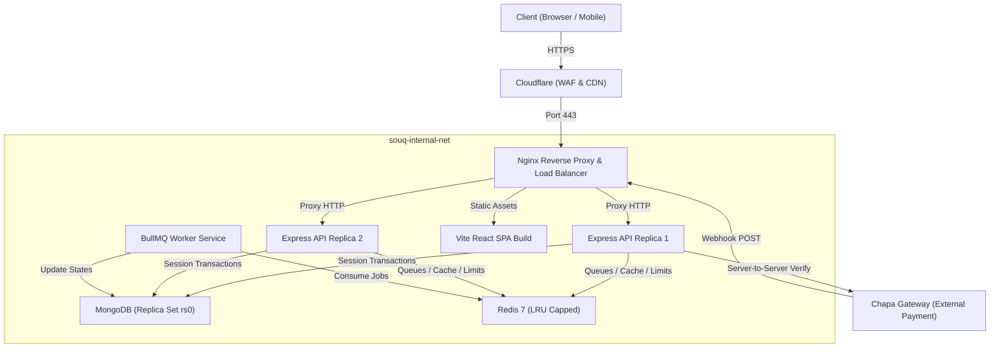

# ሱቅ SOUQ — Ethiopia's Multi-Vendor Marketplace

[](https://github.com/PROFESSOR-ADNAN/souq/actions/workflows/ci.yml)
[](LICENSE)
[](https://nodejs.org)
[](packages/shared/tsconfig.json)

> **SOUQ** is a production-grade multi-vendor e-commerce platform built specifically for the Ethiopian market. It empowers local merchants transitioning from Telegram channels and Facebook groups to manage a modern storefront, settle payments in Ethiopian Birr (**ETB**) via **Chapa** (Telebirr, CBE Birr, cards), and guarantee zero overselling through an **atomic two-phase inventory reservation engine**.

---

## 🌟 Engineering Highlights (Portfolio Reviewer Quick Links)

1. **[500-Concurrency Stock Guarantee](tests/integration/inventory-concurrency.test.js):** Proves that 500 concurrent buy attempts against 50 items results in exactly 50 orders, 450 rejections, and zero negative stock under MongoDB session transactions.
2. **[Strict Order State Machine](api/src/services/orderStateMachine.service.ts):** Finite state machine with immutable audit logging enforcing transitions from `PENDING_PAYMENT` to `DELIVERED`.
3. **[Two-Phase Inventory Reservation](api/src/services/inventory.service.ts):** 15-minute BullMQ expiration queue automatically restores stock for abandoned checkouts.
4. **[Chapa Payment Reconciliation](api/src/services/chapa.service.ts):** Constant-time HMAC-SHA256 webhook signature verification with mandatory server-to-server verification.
5. **[Financial Integrity with Integer Santim](packages/shared/src/constants/currencies.ts):** All transactions, product prices, and ledgers are stored in integer Ethiopian santim (1 ETB = 100 santim).
6. **[Ethiopic Localization & Typography](web/src/i18n/):** Seamless bilingual English and Amharic UI styled with OFL-licensed Noto Sans Ethiopic font.
7. **[11 Architectural Decision Records (ADRs)](docs/adr/):** Rigorous documentation of architectural tradeoffs.

---

## 🏛️ System Architecture



---

## 🚀 Quick Start (Local Development)

### Prerequisites
- Docker & Docker Compose
- Node.js >= 22.0.0

```bash
# 1. Clone the repository
git clone https://github.com/PROFESSOR-ADNAN/souq.git
cd souq-pp1

# 2. Setup environment variables
cp .env.example .env

# 3. Start the entire local stack (Mongo replica set, Redis, MinIO, Mailpit)
make up

# 4. Seed the database with sample categories, sellers, and products
make seed

# 5. Run automated tests
make test
```

Services will be accessible at:
- **Web Storefront:** `http://localhost:5173`
- **REST API:** `http://localhost:5000/healthz`
- **Mailpit Catcher:** `http://localhost:8025`
- **MinIO S3 Console:** `http://localhost:9001`

---

## 🧪 Testing Suite

```bash
# Run all unit and integration tests
npm test

# Run the 500-request inventory concurrency stress test
make test-concurrency
```

---

## 📜 License
Licensed under the [MIT License](LICENSE).
