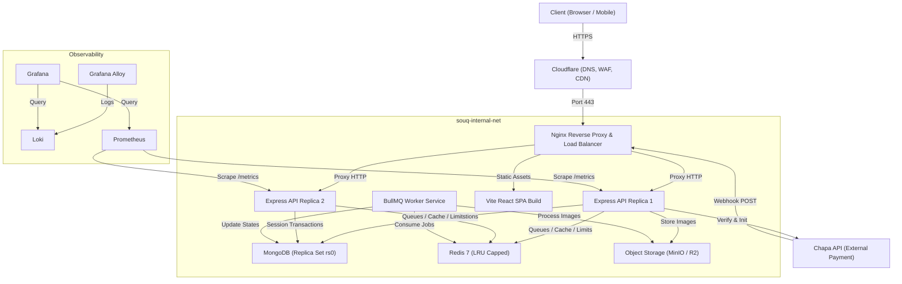
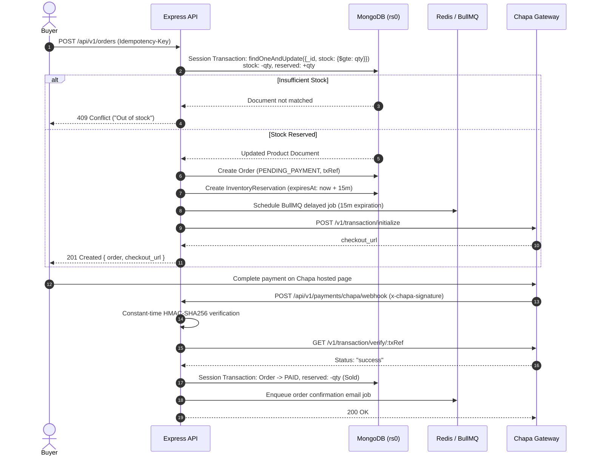
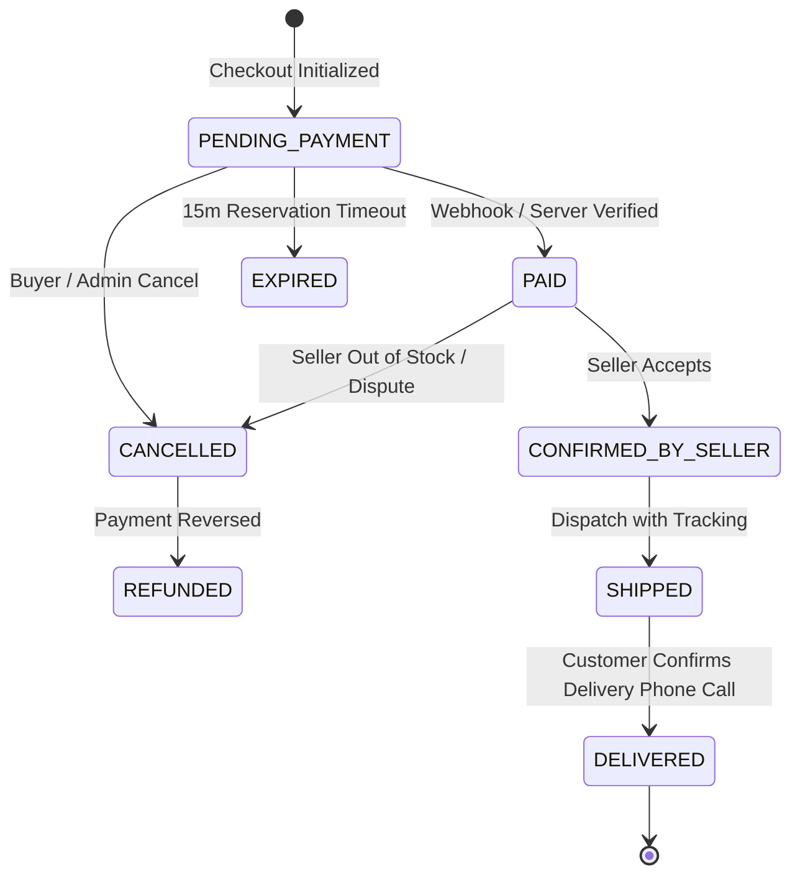

# SOUQ Architecture Specification

## 1. System Overview
SOUQ is structured as a decoupled, 12-factor application deployed on a single hardened Ubuntu VPS via Docker Compose.

## 2. Order Checkout & Inventory Reservation Sequence

## 3. Order State Machine FSM

## 4. VPS Memory Budget Table (4 GB RAM Target)

The entire production stack is strictly budgeted to ensure stable operation below 85% of 4096 MB (3481 MB max):

| Service | Container | Soft Limit | Hard Limit | Justification |
|---|---|---|---|---|
| Reverse Proxy | `souq-nginx` | 64 MB | 128 MB | Caching, rate limiting, SSL termination |
| API Instance 1 | `souq-api-1` | 192 MB | 256 MB | Stateless Express server with V8 memory cap |
| API Instance 2 | `souq-api-2` | 192 MB | 256 MB | Stateless Express server with V8 memory cap |
| Worker Service | `souq-worker` | 192 MB | 384 MB | BullMQ queues, Sharp image processing |
| Database | `souq-mongo` | 768 MB | 1024 MB | WiredTiger cache sized to 512MB + connection memory |
| Cache & Queues | `souq-redis` | 128 MB | 256 MB | In-memory keys with maxmemory 192MB volatile-lru |
| Object Store (Dev) | `souq-minio` | 128 MB | 256 MB | Dev only; production uses Cloudflare R2 |
| Observability | `souq-alloy` | 64 MB | 128 MB | Log shipping agent |
| Observability | `souq-loki` | 128 MB | 256 MB | In-memory log buffer |
| Observability | `souq-prometheus`| 192 MB | 384 MB | 15s scrape interval, 15d retention |
| Observability | `souq-grafana` | 96 MB | 192 MB | Dashboard visualization |
| OS & Host Buffer | Ubuntu Host | 400 MB | 512 MB | Kernel, SSH, fail2ban, buffers |
| **TOTAL** | | **2544 MB (62%)**| **3344 MB (81%)**| **Target < 85% PASSED** |
